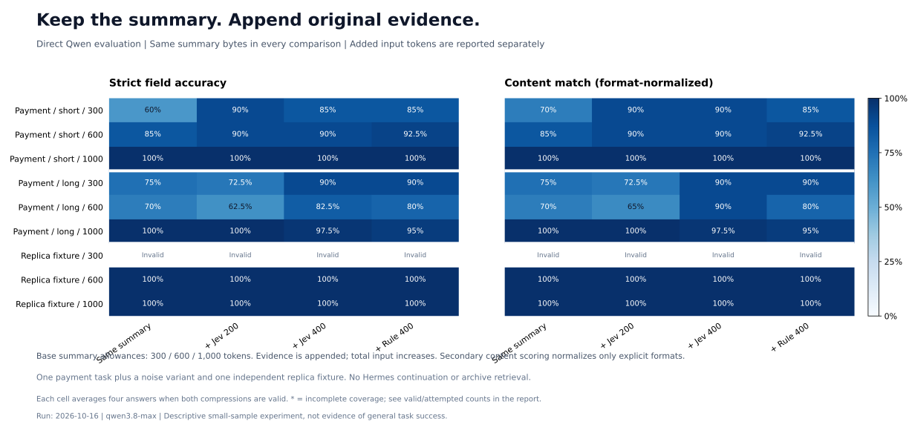
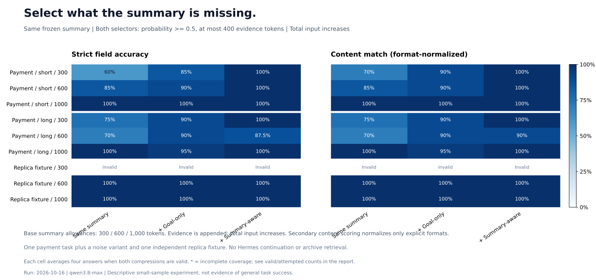
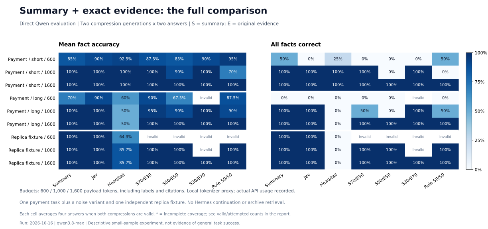

# 摘要与关键原文组合：多组评测方案与结果

2026-10-16 实跑。本轮分别回答两个问题：**固定总预算如何分配摘要与原文**，以及**同一份摘要后增量追加原文能否改善回答**。
后者是这里的主要增量对照，进一步包括按任务相关性选择和按摘要缺失内容选择两组；前者不能解释为“完整保留摘要后增加原文”。

评测直接调用 `qwen3.8-max`，不是让 Hermes 在压缩后继续运行代理循环。支付数据来自先前 Hermes 采集的
合成 trajectory；副本故障是独立合成 fixture。结果衡量信息保留、函数级修复和结构化处置检查，不能代表端到端代理成功率。

## 共同数据与评分

- 两个任务族、三份输入：支付短样本、增加 180 行例行日志的支付变体、副本故障 fixture。支付变体不是独立任务。
- 支付检查 10 个事实字段，并执行候选重试函数的 6 项行为测试；副本检查 14 个事实字段和 5 项结构化处置条件，不执行运维操作。
- 相同场景保留完全相同的 system、user 和评测题；所有组均不可检索归档。温度为 0，关闭 thinking。
- 每种配置独立生成两次压缩，每个上下文回答两次。它们是重复生成，不是四个独立任务。
- 新分块按发票号、trace ID 或 request ID 关联日志，其余长文本按约 600 字符分块；短文件整体保留。
  原始字符范围完整记录。所有对照共享该分块方式；与上一轮的差异不能只归因于混合策略。
- 原文分数由 Jev 给出，按分数降序贪心选择完整片段，再按源顺序输出。规则对照按来源倒序选择完整片段。
- 摘要和决策请求只接收任务及源证据，不接收评测题或标准答案。

主评分为冻结协议中的严格 JSON 字段匹配。以下另外报告**事后格式规范化的内容匹配率**：只接受明确的整数/布尔拼写、
整数值浮点数和 `retry.py line 5` / `retry.py:5` 等无歧义行号。不会把 `true` 当作次数 `1`，也不接受“第 5 或 7 行”。
这是区分格式差异的诊断指标，没有覆盖原始评分；后续评测应预先声明规范化规则，并在题目中明确所有字段类型。

## A. 保留同一份摘要，增量追加原文

[实现](./frozen_summary_experiment.py)。设置在该补充实验的模型调用前固定；它由用户追问触发，属于事后机制诊断，
不冒充最初的预注册方案。

1. 基础纯摘要额度取 300、600、1000 token。直接复用固定预算实验的 600/1000 生成结果，另生成两次 300-token 摘要。
2. 冻结每份摘要的原始字符串及 SHA-256；三个追加组都原样保留它，不重新总结，不缩短、不替换任何摘要内容。
3. 分别追加最多 200 / 400 token 的 Jev 原文，另追加最多 400 token 的规则原文作对照。
4. 原文额度包括来源标记。**追加后总输入增加**，这是增量收益实验，不是相同总 token 的效率比较。
5. 600/1000 的纯摘要回答复用原始记录；300-token 基础摘要和全部追加上下文重新回答两次。决策分数沿用同一生成轮次。

共有 18 份计划中的基础摘要、72 条上下文记录。副本任务的两份 300-token 摘要均超预算，其基础及追加组共 8 条记录标为无效，
没有根据答案重试。剩余 **16 份固定摘要、48 个追加上下文**有效。下表每个有效单元平均两次摘要生成、共四次回答。

单元格式为“严格得分 / 格式规范化内容匹配率”；无效不记为 0% 或当作成功样本。

| 场景 | 基础摘要额度 | 同一份纯摘要 | + Jev ≤200 | + Jev ≤400 | + 规则 ≤400 |
| --- | ---: | ---: | ---: | ---: | ---: |
| 支付短样本 | 300 | 60.0% / 70.0% | 90.0% / 90.0% | 85.0% / 90.0% | 85.0% / 85.0% |
| 支付短样本 | 600 | 85.0% / 85.0% | 90.0% / 90.0% | 90.0% / 90.0% | 92.5% / 92.5% |
| 支付短样本 | 1000 | 100.0% / 100.0% | 100.0% / 100.0% | 100.0% / 100.0% | 100.0% / 100.0% |
| 支付长日志 | 300 | 75.0% / 75.0% | 72.5% / 72.5% | 90.0% / 90.0% | 90.0% / 90.0% |
| 支付长日志 | 600 | 70.0% / 70.0% | 62.5% / 65.0% | 82.5% / 90.0% | 80.0% / 80.0% |
| 支付长日志 | 1000 | 100.0% / 100.0% | 100.0% / 100.0% | 97.5% / 97.5% | 95.0% / 95.0% |
| 副本故障 | 300 | 无效（0/2） | 无效（0/2） | 无效（0/2） | 无效（0/2） |
| 副本故障 | 600 | 100.0% / 100.0% | 100.0% / 100.0% | 100.0% / 100.0% | 100.0% / 100.0% |
| 副本故障 | 1000 | 100.0% / 100.0% | 100.0% / 100.0% | 100.0% / 100.0% | 100.0% / 100.0% |

### A1. 仅按任务相关性选择的增量收益与代价

在 16 份有效固定摘要上，Jev ≤400 的严格得分平均提高 **6.9 个百分点**：7 份提升、8 份持平、1 份下降。
事后内容匹配指标平均提高 **7.2 个百分点**，提升/持平/下降数量相同。这里的 16 份来自两个任务族的重复生成，
不构成统计显著性或通用收益证据。

规则 ≤400 的严格平均增益为 6.6 个百分点，内容指标为 5.3 个百分点；本轮不能证明相对简单规则有稳定优势。
Jev ≤200 的内容平均增益只有 2.2 个百分点，且有 2 份下降，说明更小的追加额度不一定选到互补证据。

| 场景 | 基础摘要额度 | 纯摘要总输入 | + Jev ≤400 总输入 | 增加输入 token |
| --- | ---: | ---: | ---: | ---: |
| 支付短样本 | 300 | 2826 | 3196 | 369 |
| 支付短样本 | 600 | 3114 | 3483 | 369 |
| 支付短样本 | 1000 | 3302 | 3672 | 369 |
| 支付长日志 | 300 | 2829 | 3202 | 373 |
| 支付长日志 | 600 | 3070 | 3443 | 373 |
| 支付长日志 | 1000 | 3292 | 3665 | 373 |
| 副本故障 | 600 | 2875 | 3230 | 355 |
| 副本故障 | 1000 | 3098 | 3452 | 355 |

典型改善：支付长日志的 600-token 摘要漏掉最大尝试次数、不可重试状态码和测试次数；追加 400-token 原文后，
严格得分由 70% 到 82.5%，内容指标到 90%，平均总输入由 3070 到 3443 token。选中的策略与代码补回了部分约束，
但没有补齐所有测试数据。

唯一的 Jev ≤400 回退发生在已达满分的支付长日志 1000-token 摘要：一次追加后的回答把
`key = str(uuid.uuid4())` 填入“行号”字段，另一回答正确，导致该摘要实例从 100% 到 95%。
摘要字节未改变，因此不能将这个回退归因于摘要被挤掉；**输入信息没有减少，不等于模型回答质量保证单调提高**。
它是回答字段错误，也不足以证明追加造成了事实遗忘。

同时，1000-token 纯摘要在这三份输入上已达 100% 严格事实得分；其平均输入比部分 600+400 组合更少。
因此“已有摘要的增量补强有效”和“组合是最优 token 分配”是两个不同结论。本轮只支持前者在部分实例成立。

### A2. 让决策模型看到冻结摘要，再选缺失证据

[实现](./summary_aware_experiment.py)。这是另行注册协议的事后对照：Jev 同时接收当前任务、同一份冻结摘要和
候选原文，判断“该片段是否补充摘要缺失、不准确或精度不足的信息，或者提供必要的逐字证据”。不提供评测题或标准答案。

两组均只选择概率 `>=0.5` 的片段，并限制原文最多 400 token：

- **任务相关性对照**：使用原来只看任务的分数，同样加上 0.5 阈值。
- **摘要感知组**：根据实际冻结摘要重新评分，优先选择互补内容。

相同上下文复用同一组回答，避免相同输入的随机差异制造方案差异；摘要仍逐字不变。
阈值在该轮调用前固定，没有据答案调整，但它也没有经过独立数据校准。

单元仍为“严格得分 / 格式规范化内容匹配率”；每个有效单元有两份冻结摘要实例。

| 场景 | 基础摘要额度 | 同一份纯摘要 | + 任务相关性，阈值0.5 | + 摘要感知，阈值0.5 |
| --- | ---: | ---: | ---: | ---: |
| 支付短样本 | 300 | 60.0% / 70.0% | 85.0% / 90.0% | 100.0% / 100.0% |
| 支付短样本 | 600 | 85.0% / 85.0% | 90.0% / 90.0% | 100.0% / 100.0% |
| 支付短样本 | 1000 | 100.0% / 100.0% | 100.0% / 100.0% | 100.0% / 100.0% |
| 支付长日志 | 300 | 75.0% / 75.0% | 90.0% / 90.0% | 100.0% / 100.0% |
| 支付长日志 | 600 | 70.0% / 70.0% | 90.0% / 90.0% | 87.5% / 90.0% |
| 支付长日志 | 1000 | 100.0% / 100.0% | 95.0% / 95.0% | 100.0% / 100.0% |
| 副本故障 | 600 | 100.0% / 100.0% | 100.0% / 100.0% | 100.0% / 100.0% |
| 副本故障 | 1000 | 100.0% / 100.0% | 100.0% / 100.0% | 100.0% / 100.0% |

摘要感知组在 16 份有效冻结摘要上，严格平均增益为 **12.2 个百分点**：7 份提高、9 份持平、未观察到下降。
事后内容指标平均提高 **11.3 个百分点**，提升/持平/下降数量相同。
相同阈值的任务相关性对照严格平均增益为 7.5 个百分点（7 提升、8 持平、1 下降）。
这些是按有效摘要实例等权的描述性平均，支付增噪变体和重复生成并非独立任务；大部分增益来自支付任务，副本基线已经满分。

支付短样本 300-token 摘要的严格得分从 60% 到 100%，支付长日志同档从 75% 到 100%；
600-token 长日志从 70% 到 87.5%，其内容指标为 90%。对应的总输入分别从 2826 到 3222、2829 到 3224、3070 到 3452。
在本轮各单元中，摘要感知组平均新增约 270—396 个实际输入 token；没有凭借压缩摘要换取原文空间。

这更支持**先生成摘要，再按“相对于这份摘要的增量价值”选择少量原文**的方向。不能把“本轮未观察到下降”视为单调性保证，
也不能把事后在相同任务上的改进当成独立测试集上的泛化。原文额度、概率阈值和总输入仍需宿主检查；此方案尚未进入生产压缩步骤。

## B. 固定总预算的配比实验

[实现](./hybrid_experiment.py)。原始矩阵在推理前固定：完整证据参照，加上三档总额度（600/1000/1600）下的
纯摘要、纯 Jev 原文、首尾截取、摘要/原文 70/30、50/50、30/70，以及规则 50/50，共 132 个上下文。

正文预算包括标题和来源标记，先预留边界开销，再按比例分配；未用完额度不在生成后转移。
混合组根据完整证据和选中片段重新生成更短摘要，提示避免重复原文。模型生成超预算或截断即记无效。
预算使用本地 Qwen3.5 tokenizer 代理；总输入来自 Qwen API usage，两者不混为一谈。

120/132 个上下文有效，12 个摘要超预算。1000、1600 总预算下，三份输入的纯摘要及纯原文筛选均达 100% 严格事实得分。
1600 预算下混合组也达到满分，没有显示出额外质量增益。600 预算下结果依赖分配与场景，部分组合不如纯摘要，
副本的若干混合组无法满足小摘要额度。

全部固定预算结果（有效压缩数、严格评分、全部事实正确率与任务检查）

| 场景 | 总额度 | 方案 | 有效/计划 | 严格事实 | 全部事实正确 | 任务检查全通过 | 总输入 token |
| --- | ---: | --- | ---: | ---: | ---: | ---: | ---: |
| 支付短样本 | 不限 | full | 2/2 | 100.0% | 100.0% | 100.0% | 4720 |
| 支付短样本 | 600 | summary | 2/2 | 85.0% | 50.0% | 100.0% | 3114 |
| 支付短样本 | 600 | spans | 2/2 | 90.0% | 0.0% | 100.0% | 3129 |
| 支付短样本 | 600 | head_tail | 2/2 | 92.5% | 25.0% | 100.0% | 3193 |
| 支付短样本 | 600 | hybrid70 | 2/2 | 87.5% | 0.0% | 100.0% | 3082 |
| 支付短样本 | 600 | hybrid50 | 2/2 | 85.0% | 0.0% | 100.0% | 3112 |
| 支付短样本 | 600 | hybrid30 | 2/2 | 90.0% | 0.0% | 100.0% | 3136 |
| 支付短样本 | 600 | rule_hybrid50 | 2/2 | 95.0% | 50.0% | 100.0% | 3088 |
| 支付短样本 | 1000 | summary | 2/2 | 100.0% | 100.0% | 100.0% | 3302 |
| 支付短样本 | 1000 | spans | 2/2 | 100.0% | 100.0% | 100.0% | 3392 |
| 支付短样本 | 1000 | head_tail | 2/2 | 100.0% | 100.0% | 100.0% | 3593 |
| 支付短样本 | 1000 | hybrid70 | 2/2 | 100.0% | 100.0% | 100.0% | 3474 |
| 支付短样本 | 1000 | hybrid50 | 2/2 | 90.0% | 0.0% | 100.0% | 3444 |
| 支付短样本 | 1000 | hybrid30 | 2/2 | 100.0% | 100.0% | 100.0% | 3477 |
| 支付短样本 | 1000 | rule_hybrid50 | 2/2 | 70.0% | 0.0% | 100.0% | 3446 |
| 支付短样本 | 1600 | summary | 2/2 | 100.0% | 100.0% | 100.0% | 3602 |
| 支付短样本 | 1600 | spans | 2/2 | 100.0% | 100.0% | 100.0% | 3817 |
| 支付短样本 | 1600 | head_tail | 2/2 | 100.0% | 100.0% | 100.0% | 4193 |
| 支付短样本 | 1600 | hybrid70 | 2/2 | 100.0% | 100.0% | 100.0% | 3858 |
| 支付短样本 | 1600 | hybrid50 | 2/2 | 100.0% | 100.0% | 100.0% | 4000 |
| 支付短样本 | 1600 | hybrid30 | 2/2 | 100.0% | 100.0% | 100.0% | 3766 |
| 支付短样本 | 1600 | rule_hybrid50 | 2/2 | 100.0% | 100.0% | 100.0% | 3968 |
| 支付长日志 | 不限 | full | 2/2 | 100.0% | 100.0% | 100.0% | 10792 |
| 支付长日志 | 600 | summary | 2/2 | 70.0% | 0.0% | 100.0% | 3070 |
| 支付长日志 | 600 | spans | 2/2 | 90.0% | 0.0% | 100.0% | 3133 |
| 支付长日志 | 600 | head_tail | 2/2 | 60.0% | 0.0% | 100.0% | 3193 |
| 支付长日志 | 600 | hybrid70 | 2/2 | 90.0% | 0.0% | 100.0% | 3078 |
| 支付长日志 | 600 | hybrid50 | 2/2 | 67.5% | 0.0% | 100.0% | 3063 |
| 支付长日志 | 600 | hybrid30 | 0/2 | — | — | — | — |
| 支付长日志 | 600 | rule_hybrid50 | 2/2 | 87.5% | 0.0% | 100.0% | 3105 |
| 支付长日志 | 1000 | summary | 2/2 | 100.0% | 100.0% | 100.0% | 3292 |
| 支付长日志 | 1000 | spans | 2/2 | 100.0% | 100.0% | 100.0% | 3553 |
| 支付长日志 | 1000 | head_tail | 2/2 | 50.0% | 0.0% | 100.0% | 3593 |
| 支付长日志 | 1000 | hybrid70 | 2/2 | 95.0% | 50.0% | 100.0% | 3376 |
| 支付长日志 | 1000 | hybrid50 | 2/2 | 90.0% | 0.0% | 100.0% | 3452 |
| 支付长日志 | 1000 | hybrid30 | 2/2 | 100.0% | 100.0% | 100.0% | 3458 |
| 支付长日志 | 1000 | rule_hybrid50 | 2/2 | 90.0% | 50.0% | 100.0% | 3440 |
| 支付长日志 | 1600 | summary | 2/2 | 100.0% | 100.0% | 100.0% | 3683 |
| 支付长日志 | 1600 | spans | 2/2 | 100.0% | 100.0% | 100.0% | 4073 |
| 支付长日志 | 1600 | head_tail | 2/2 | 50.0% | 0.0% | 100.0% | 4193 |
| 支付长日志 | 1600 | hybrid70 | 2/2 | 100.0% | 100.0% | 100.0% | 3846 |
| 支付长日志 | 1600 | hybrid50 | 2/2 | 100.0% | 100.0% | 100.0% | 3834 |
| 支付长日志 | 1600 | hybrid30 | 2/2 | 100.0% | 100.0% | 100.0% | 4073 |
| 支付长日志 | 1600 | rule_hybrid50 | 2/2 | 100.0% | 100.0% | 100.0% | 3964 |
| 副本故障 | 不限 | full | 2/2 | 100.0% | 100.0% | 100.0% | 9903 |
| 副本故障 | 600 | summary | 2/2 | 100.0% | 100.0% | 100.0% | 2875 |
| 副本故障 | 600 | spans | 2/2 | 100.0% | 100.0% | 100.0% | 2856 |
| 副本故障 | 600 | head_tail | 2/2 | 64.3% | 0.0% | 0.0% | 2946 |
| 副本故障 | 600 | hybrid70 | 0/2 | — | — | — | — |
| 副本故障 | 600 | hybrid50 | 0/2 | — | — | — | — |
| 副本故障 | 600 | hybrid30 | 0/2 | — | — | — | — |
| 副本故障 | 600 | rule_hybrid50 | 0/2 | — | — | — | — |
| 副本故障 | 1000 | summary | 2/2 | 100.0% | 100.0% | 100.0% | 3098 |
| 副本故障 | 1000 | spans | 2/2 | 100.0% | 100.0% | 100.0% | 3259 |
| 副本故障 | 1000 | head_tail | 2/2 | 85.7% | 0.0% | 0.0% | 3346 |
| 副本故障 | 1000 | hybrid70 | 2/2 | 100.0% | 100.0% | 100.0% | 3200 |
| 副本故障 | 1000 | hybrid50 | 2/2 | 100.0% | 100.0% | 100.0% | 3206 |
| 副本故障 | 1000 | hybrid30 | 0/2 | — | — | — | — |
| 副本故障 | 1000 | rule_hybrid50 | 2/2 | 100.0% | 100.0% | 100.0% | 3285 |
| 副本故障 | 1600 | summary | 2/2 | 100.0% | 100.0% | 100.0% | 3422 |
| 副本故障 | 1600 | spans | 2/2 | 100.0% | 100.0% | 100.0% | 3909 |
| 副本故障 | 1600 | head_tail | 2/2 | 85.7% | 0.0% | 0.0% | 3946 |
| 副本故障 | 1600 | hybrid70 | 2/2 | 100.0% | 100.0% | 100.0% | 3562 |
| 副本故障 | 1600 | hybrid50 | 2/2 | 100.0% | 100.0% | 100.0% | 3740 |
| 副本故障 | 1600 | hybrid30 | 2/2 | 100.0% | 100.0% | 100.0% | 3844 |
| 副本故障 | 1600 | rule_hybrid50 | 2/2 | 100.0% | 100.0% | 100.0% | 3660 |

“任务检查全通过”对支付表示六项可执行修复测试，对副本表示五项结构化处置条件，二者不等价于真实代理任务成功。
表内正确率仅对有效上下文计算；完整表保留无效数量，不能忽略失败率挑选最优方案。

## 复现与校验

[README](./README.md#hybrid-summary-and-exact-evidence-experiment) 提供固定预算命令；增量对照与离线分析命令也在该目录说明中。
[analyze_hybrid.py](./analyze_hybrid.py) 复算严格评分，并将事后格式规范化指标另存，原始记录不改写。
各轮报告、协议、案例、原始请求/响应、来源范围、模型 usage 和冻结摘要哈希均保留在仓库外：

- `trajectory-runs/compaction-hybrid-20261016/`：固定预算实验。
- `trajectory-runs/compaction-incremental-20261016/`：增量对照、`analysis.json` 与 `audit.json`。
- `trajectory-runs/compaction-summary-aware-20261016/`：摘要感知与同阈值任务相关性对照。

路径相对于本次本地 `/Users/yuli/workspace/`；运行产物与原始支付 trajectory 没有作为公共数据集发布。
副本 fixture 可以从源码生成。精确复现支付结果需要原始 trajectory、tokenizer JSON 和模型服务；供应商响应可能变化。

已独立复核源 trajectory 未改变、有效固定预算全部满足上限、保护消息和评测提示一致、原文范围准确、
增量摘要逐字相同、摘要未接收评测题或标准答案、产物没有 API Key。严格评分复算保持一致。
模型调用发生在各轮实跑中，绘图和离线分析不访问模型服务。usage 分提供商记录，未按价格换算费用，
也未验证长会话缓存成本、原文恢复及 Hermes 端到端表现。

### 实际模型调用记录

以下按唯一响应文件统计，不重复计算复用的纯摘要回答或跨配比共享的 Jev 分数。

| 调用 | 次数 | 输入 token | 输出 token |
| --- | ---: | ---: | ---: |
| 固定预算 Qwen：90 次摘要 + 240 次回答 | 330 | 2,127,028 | 94,244 |
| 增量 Qwen：6 次摘要 + 104 次回答 | 110 | 422,316 | 23,581 |
| Jev：固定预算阶段评分，普通增量阶段复用 | 18 | 49,378 | 3,184 |
| 摘要感知对照 Qwen：仅新增回答 | 62 | 211,748 | 13,122 |
| 摘要感知 Jev：根据每份冻结摘要重新评分 | 46 | 151,090 | 8,196 |

实际响应记录的模型分别为 `qwen3.8-max` 与 `jev-1.13.0`。
不同提供商的 token 不直接折算成相同费用；并发数为 4，耗时不作为单请求隔离性能基准。
