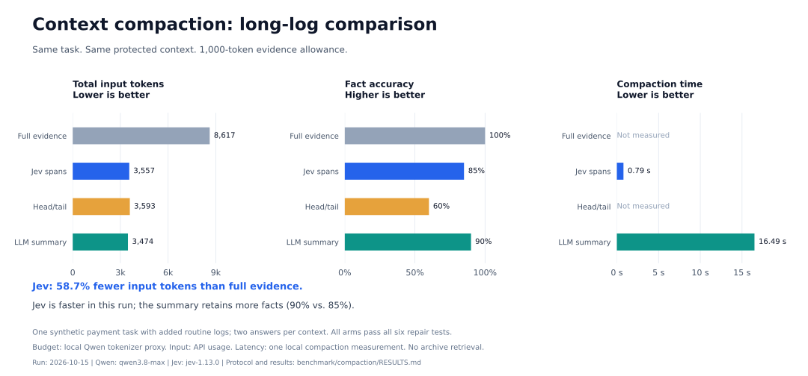

# 决策模型上下文压缩：评测方案与结果

2026-10-15 本地实跑。分块筛选在本轮体现了输入压缩和较短的压缩耗时，但没有稳定优于普通摘要。
这些结果来自一个合成支付任务及其日志增噪变体，不能代表通用任务成功率。

## 数据与对照方案

原始数据由本地 Hermes 调用 `qwen3.8-max` 采集：完整 trajectory 含实际 system prompt、11 条消息、
6 次工具调用和 6 条配对的工具结果。工具读取支付重试源码、支付策略、故障日志、预期测试和无关 UI 事项。
评测先移除已经包含答案的最后一条 assistant 报告，留下 10 条消息。

两份输入分别是：

- **原始短样本**：保留采集到的工具结果，分成 9 个证据片段。
- **长日志合成变体**：在原始日志事件之间插入 180 行健康检查，保留原始日志文字，分成 32 个证据片段。
  这是同一任务的受控变体，没有重新采集 trajectory，也不构成第二个独立任务。

| 方案 | 做法 |
| --- | --- |
| 完整证据 | 所有工具文本和来源信息，作为不受预算约束的参照 |
| Jev 分块筛选 | 长结果按行边界组成约 600 字符的片段，短源码和 JSON 保留整体；逐块判断任务相关性，按概率从高到低选取能放入预算的完整片段，按原始顺序输出 |
| 首尾截取 | 对完整证据容器保留首尾 token，中间添加省略标记 |
| 普通摘要 | Qwen 根据工具历史生成结构化交接摘要，保留目标、约束、发现、决定、文件、后续行动与关键上下文 |

分块策略见 [span_experiment.py](./span_experiment.py)，不改变生产 `compact_context` 按工具配对判断、
仅对低概率结果生成可恢复预览的行为。这里采用预算排序，没有沿用生产的 `drop_threshold=0.1`。
普通摘要直接调用 Qwen，不等同于 Hermes 的自动压缩流程。

## 固定协议与计量

- 在模型推理前保存两份输入、评测题、标准答案及协议。Jev 和摘要生成器只接收任务与历史证据，不接收评测题或标准答案。
- 摘要与后续回答模型均为 `qwen3.8-max`，温度为 `0`，关闭 thinking；Jev 响应记录的模型为 `jev-1.13.0`。
- 证据正文预算固定为 **600 / 1000 token**，使用本地 Qwen3.5-9B tokenizer JSON 计数。
  它是服务端 tokenizer 的代理；报告的总输入 token 来自 Qwen API usage。预算包括证据中的来源标记。
- 预算是共同上限，不强制填满。原始 system 和 user 请求在所有组中保持一致，另加同一评测提示。
  工具历史统一转换成带文件与字符偏移的证据容器，不直接比较原始 API 工具消息封装。
- 摘要提示同时限制为预算一半的英文词数，生成上限为 2048 token；评测回答上限为 2400 token。
  超预算摘要标记无效，截断响应中止运行。本轮全部 14 个上下文有效，没有据评分重试或调参。
- 每个上下文回答两次，共 **28 次评测回答**。每个场景、每档预算只生成一次摘要；Jev 分数在同一场景的两档预算间复用。
  重复回答不等于独立任务或独立压缩样本。
- 所有组均不提供原文恢复工具。只生成候选修复函数，在隔离的测试数据上执行，不调用真实支付服务。

## 评分

使用确定性检查，不用 LLM 充当裁判。评分实现见 [run.py](./run.py) 的 `grade` 和
[repair_check.py](./repair_check.py)。

**事实正确率**：每次回答检查 10 个字段，覆盖事件号、发票号、成功支付号、金额、两次幂等键、首次超时是否已提交、
最大尝试次数、不可重试状态码、原始生成键的代码行号，以及三项测试的预期尝试次数。
复合字段必须整体匹配，最后对两次回答取平均。

另有 3 个结构化修复计划检查：键在循环外生成、仅重试 `TimeoutError`、耗尽后抛出最后的超时异常。
这些检查与事实分开记录在原始结果中，不混入下表的事实正确率。

**修复全通过率**：候选 `charge_with_retry` 函数通过以下全部 6 项行为测试才算一次修复通过：

1. 正常成功仅调用一次并返回结果。
2. 超时后成功，重试复用同一幂等键。
3. HTTP 402 不重试。
4. HTTP 422 不重试。
5. 三次超时后抛出最后一个原始异常，并保持同一幂等键。
6. 两次独立支付使用不同的幂等键。

评分器只接受受限 Python 函数语法与有界循环，注入假的 UUID 和支付客户端。
这是函数级修复验证，不是完整代理任务的端到端验收。

## 实测结果

“总输入”包含共同的 system、user、评测提示和证据封装，来自 API usage；“证据”是本地 tokenizer 的计数。
事实正确率和修复全通过率为两次回答的平均值，压缩耗时为该上下文的一次压缩测量。

| 场景 | 方案 | 预算 | 证据 token | 总输入 token | 事实正确率 | 修复全通过 | 压缩秒数 |
| --- | --- | ---: | ---: | ---: | ---: | ---: | ---: |
| 原始 | 完整证据 | 不限 | 1772 | 4369 | 100% | 100% | — |
| 原始 | Jev 分块 | 600 | 549 | 3146 | 90% | 100% | 0.86 |
| 原始 | 首尾截取 | 600 | 596 | 3193 | 90% | 100% | — |
| 原始 | 普通摘要 | 600 | 512 | 3109 | 90% | 100% | 10.80 |
| 原始 | Jev 分块 | 1000 | 715 | 3312 | 100% | 100% | 0.86 |
| 原始 | 首尾截取 | 1000 | 996 | 3593 | 100% | 100% | — |
| 原始 | 普通摘要 | 1000 | 850 | 3447 | 90% | 100% | 17.06 |
| 长日志变体 | 完整证据 | 不限 | 6020 | 8617 | 100% | 100% | — |
| 长日志变体 | Jev 分块 | 600 | 559 | 3156 | 70% | 100% | 0.79 |
| 长日志变体 | 首尾截取 | 600 | 596 | 3193 | 60% | 100% | — |
| 长日志变体 | 普通摘要 | 600 | 481 | 3078 | 80% | 100% | 9.53 |
| 长日志变体 | Jev 分块 | 1000 | 960 | 3557 | 85% | 100% | 0.79 |
| 长日志变体 | 首尾截取 | 1000 | 996 | 3593 | 60% | 100% | — |
| 长日志变体 | 普通摘要 | 1000 | 877 | 3474 | 90% | 100% | 16.49 |

长日志 1000 token 预算下，Jev 总输入从 8617 降至 3557，减少 **58.7%**；普通摘要降至 3474，减少 **59.7%**。
原始样本的同档预算下，Jev 保留全部事实，但长日志中的两档预算均落后于摘要。
Jev 本轮压缩耗时约 0.8 秒，摘要为 9.5—17.1 秒；首尾截取的耗时未单独测量。
Jev 耗时包含并发批次评分，分数跨预算复用，不能把两档预算当成两次独立的成本测量。
输入减少不等于账单节省，尚未根据供应商价格、缓存命中和后续恢复计算总费用。

## 遗漏与结论

长日志中，包含“首次请求超时但服务端已提交”的片段与多条健康检查混在一起，被 Jev 评为 `0.39`；
第二次成功请求片段得分 `0.90`。前者未被预算策略选中，导致首次提交状态和幂等键信息遗漏。
600 预算还未保留预期测试片段。固定字符窗口与按分数贪心选择没有保证同一事件链完整。

普通摘要也有遗漏：长日志 600 预算漏掉最大重试次数和不重试状态码，1000 预算仍漏掉不重试状态码。
全部方案均通过六项修复测试，说明本例修复任务未能区分压缩方案；不能将 100% 解读为普遍可靠。

本轮支持继续研究分块筛选：它减少输入、比简单首尾截取保留更多长日志事实，且压缩延迟较低。
相对普通摘要的质量优势只出现在短样本的部分预算，尚未稳定成立。
后续应预先固定按日志事件分块、关联事件保留等策略，并在新增独立任务上检验，避免只对本例调参。

## 复现与产物

安装、凭证和命令见 [README 的复现说明](./README.md#matched-budget-span-experiment)。
复现需要原始 `trajectory.full.json` 和本地 tokenizer JSON；此处没有把采集的运行数据作为公共数据集发布。
选择一个新的仓库外目录保存产物，脚本会拒绝覆盖已有目录。

本次本地产物目录为 `/Users/yuli/workspace/trajectory-runs/compaction-spans-20261015/`，原始采集目录为
`/Users/yuli/workspace/trajectory-runs/hermes-qwen38max-20261015-190749/`。这些路径仅标识本地证据，其他环境需要提供自己的副本。

| 产物 | 内容 |
| --- | --- |
| `protocol.json` | 固定预算、题目、标准答案、模型设置和输入/tokenizer 哈希 |
| `*.source.json` | 两份输入与全部证据片段 |
| `*.scores.json`、`*.decision*.request.json` / `response.json` | Jev 观测内容、问题、概率、模型版本和 usage |
| `*.context.json`、`*.trial*.request.json` / `response.json` | 实际评测上下文、原始回答与 usage |
| `*.summary*.request.json` / `response.json` | 摘要生成提示与响应 |
| `results.json`、`usage.json` | 每次回答的确定性评分与调用记录 |
| `REPORT_ZH.md`、`validation.json`、`code/` | 本地报告、独立复核结果及实验代码副本 |

本次已复核原始 trajectory 未改变、所有组满足预算、保护消息一致、所选原文片段一致、评分复算一致，
产物未包含 API Key。原始请求、响应和运行产物保留在仓库外；仓库只维护方案、结果说明和复现代码。

## 后续混合策略实验

2026-10-16 增加了[固定预算配比与固定摘要增量追加对照](./HYBRID_RESULTS.md)。
它们使用新的关联事件分块，需在各自轮次内比较；本页保留 2026-10-15 的原始方案和结果。
