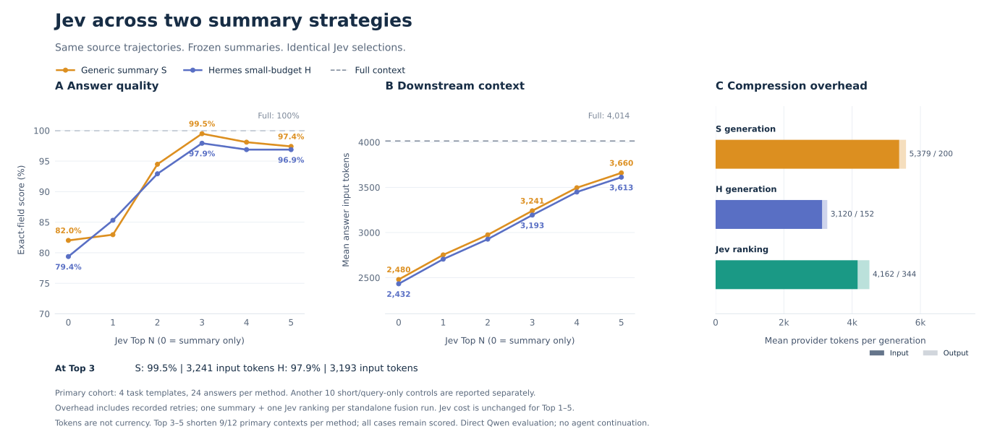

# 两种摘要机制下的 Jev 增益

[English](./RESULTS.md) | **简体中文**

2026-10-16 · Qwen `qwen3.8-max` · Jev `jev-1.13.0`。

一个 **13 组对照实验**：Full context、通用摘要 **S + Top 0～5**、Hermes 上下文压缩摘要（小预算版）
**H + Top 0～5**。Top 0 表示纯摘要。两条曲线使用相同的原始证据与固定 Jev 排名；每轮摘要在其六种条件中逐字不变。

## 四个主任务

| 方法 | 字段正确率 | Qwen 回答输入 tokens |
| --- | ---: | ---: |
| Full context | 100.0% | 4,014 |
| S | 82.0% | 2,480 |
| S + Jev Top 1 | 83.0% | 2,753 |
| S + Jev Top 2 | 94.5% | 2,974 |
| S + Jev Top 3 | 99.5% | 3,241 |
| S + Jev Top 4 | 98.1% | 3,496 |
| S + Jev Top 5 | 97.4% | 3,660 |
| H（Hermes，小预算版） | 79.4% | 2,432 |
| H + Jev Top 1 | 85.3% | 2,705 |
| H + Jev Top 2 | 92.9% | 2,927 |
| H + Jev Top 3 | 97.9% | 3,193 |
| H + Jev Top 4 | 96.9% | 3,448 |
| H + Jev Top 5 | 96.9% | 3,613 |

本组任务中两种摘要均能从追加原文中获益：Top 3 将 S 从 **82.0% 提升至 99.5%**，将 H 从
**79.4% 提升至 97.9%**。Top 3 的平均回答输入分别为 **3241／3193 tokens**，Full 为 **4014 tokens**，
对应减少 **19.3%／20.4%**。Top 4～5 未提高这些点估计。这是四个合成任务模板上的探索结果，
不代表通用的最优 N、与 Full 统计等价，也不证明 Jev 优于其他等预算选择器。

回答输入使用下游 Qwen API 的实际 usage，包含原始 system／任务、压缩历史与评测问题，
不包含摘要生成或 Jev 排名请求。图中仅报告严格字段正确率和下游上下文长度。

## 设置与适用边界

[任务、标准答案与评分](./STUDY_ZH.md) · [实验设置与复现](./SETTINGS_ZH.md) · [运行命令](./README_ZH.md)。

共 **14 个任务模板**：1 条已有支付轨迹，加上基于上游合成任务只读改写、实际运行 Hermes 采集的 13 条轨迹。
4 个主任务在采集前按来源长度确定；10 个短任务／仅依赖问题的对照单独报告。每个任务 3 轮摘要／排名，
每种条件回答 2 次，共 **546 个上下文、1092 次回答**。扩展实验复用全部 42 份 H 摘要、排名及已有 672 次回答，
只新增 420 次回答，没有新增摘要或 Jev 调用。全部 1092 次评分均已对照保存的请求／响应离线重算。

评分使用预设的递归、类型严格的 JSON 字段规则，没有 LLM judge。评测问题、标准答案和采集结束时的最终报告
均不进入摘要或决策输入。回答阶段直接调用 Qwen，不继续 Hermes 工具循环，也不恢复原文。
S、H 的摘要正文上限均为 64～256 tokens，但提示词及实际长度不同。
H 复用 Hermes 的摘要生成流程，采用 `tail_mode=legacy`、较小的摘要预算及附加长度约束；
直接调用生成器，绕过自动触发和首尾窗口选择。全部 42 个纯 H 上下文严格短于 Full，未接受原文回退。

Top N 追加完整证据块，不截断；可用块不足 N 时保留全部。支付来源有 10 块，最多 Top 10；本实验测试 Top 1～5。
沿用原有按任务预设的完整输入上限，不按回答结果调整。本比较逐步追加原文，**并非等长比较**。
全部条件满足其上限，但 Top 3～5 每种方法只有 **9/12 个主任务上下文**短于配对 Full。
新增 H 融合组有 172/210 个上下文实现缩短，其余 38 个包括 9 个主任务上下文和 29 个对照上下文。
全部保留评分，平均节省不代表每个样例都节省。

十个短任务／仅依赖问题的对照

| 方法 | 字段正确率 | Qwen 回答输入 tokens |
| --- | ---: | ---: |
| Full context | 100.0% | 2,727 |
| S | 67.1% | 2,315 |
| S + Jev Top 1 | 84.7% | 2,493 |
| S + Jev Top 2 | 87.5% | 2,573 |
| S + Jev Top 3 | 92.9% | 2,687 |
| S + Jev Top 4 | 92.9% | 2,722 |
| S + Jev Top 5 | 92.5% | 2,722 |
| H（Hermes，小预算版） | 73.2% | 2,308 |
| H + Jev Top 1 | 80.1% | 2,486 |
| H + Jev Top 2 | 92.5% | 2,566 |
| H + Jev Top 3 | 99.2% | 2,680 |
| H + Jev Top 4 | 99.2% | 2,715 |
| H + Jev Top 5 | 98.8% | 2,715 |

这些对照不能视为额外十个长上下文任务。来源块数较少时，Top N 会达到可用数量上限。

审计与产物位置

审计校验来源哈希、固定 S／H、完全一致且嵌套的 Top-N 原文、实际请求输入、全部 1092 次评分、
实际 token 上限、原有结果未变和配置密钥未泄露。全部 546 种条件有效。
早期回答格式修正和 Hermes 长度预检的记录说明保留在[实验方案](./STUDY_ZH.md)。

以下产物位于 `/Users/yuli/workspace/trajectory-runs/`，不进入 Git：
`hermes-fixture14-20261016/`（语料）、`compaction-fixture14-20261016-v2/`（S／排名）、
`compaction-fixture14-hermes-adapted-20261016/`（H）、`compaction-fixture14-final-20261016/`（原八组结果），
以及 `compaction-fixture14-dual-summary-20261016/`（当前 13 组结果、usage 与审计）。

