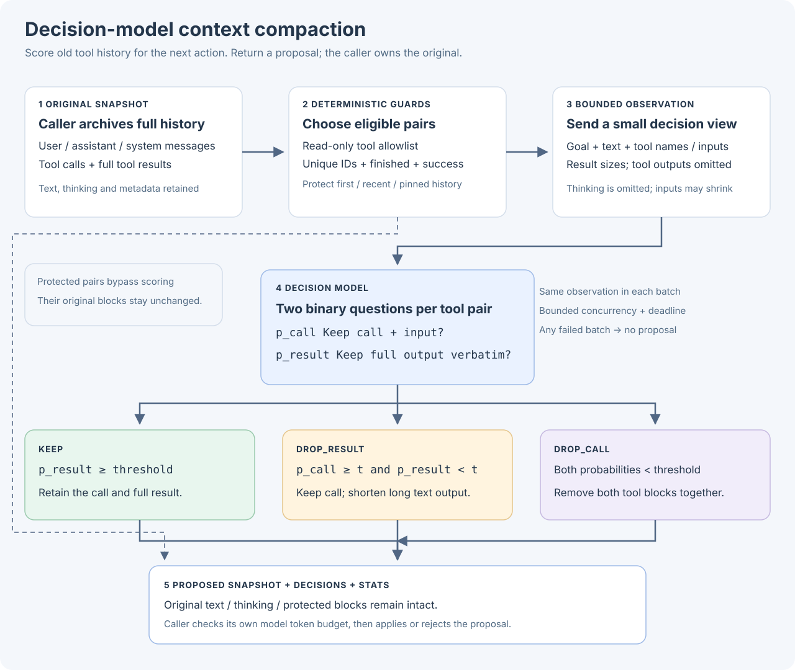

# Context compaction with decision models

`compact_context` proposes recoverable previews of old tool results. It scores evidence for the current task,
keeps tool calls and uncertain evidence, and leaves source history under the host's control. The provider-independent
`as_decision_model` interface currently supports AgentScope's TypeSafe/Jev adapter.



## How it works

1. **Archive first.** Supply an AgentScope 2.x JSON message snapshot, `goal`, optional `next_action`, a read-only tool
   allowlist, and `source_refs` mapping original call IDs to recoverable archive locations. References are opaque host
   identifiers: ReMe does not open, verify, or create them. The host must archive before applying a proposal and provide
   a retrieval tool that resolves them. No reference means no compaction for that pair.
2. **Protect structure and indispensable evidence.** Pair unique `tool_call` / `tool_result` IDs. First, system, recent,
   explicitly protected messages and calls stay intact. Failed/unfinished calls, non-text results, invalid inputs,
   mismatched tool names, and ambiguous pairs stay intact. `eligible_tool_names` defaults to empty.
3. **Show bounded evidence.** Each request contains its own candidate units: tool name, input, result head/tail preview,
   character count and completeness flags. It also carries the goal, next action and bounded first/system/protected/recent text. Thinking is
   not sent. Hosts must sanitize inputs and outputs before inference; previews may contain source data.
4. **Ask one question per pair.** Does this evidence contain information needed to continue correctly? The question
   measures usefulness, not irrecoverability. Missing or truncated context expresses uncertainty. Oversized units are
   left unobserved and retained; they are never scored after their evidence has been removed.
5. **Replace only clearly unnecessary results.** At probability `<= drop_threshold` (default `0.1`), a result can become
   a verbatim head/tail excerpt plus its source reference. Higher, invalid, or missing probabilities retain the result.
   Provider errors and timeouts retain the affected evidence; external cancellation propagates after requests drain.

No tool call or message is deleted. Replacements occur only when shorter. User/assistant text, thinking, metadata and
source inputs remain unchanged. Explicitly protect constraints, audit receipts and unique evidence; probabilities are
not substitutes for host protection rules. The threshold is a conservative starting point, not a calibrated guarantee.

## Configure and call

```bash
pip install "reme-ai[core,decision]"
export DECISION_MODEL_API_KEY=your-typesafe-api-key
export DECISION_MODEL_BACKEND=agentscope
# Optional: DECISION_MODEL_NAME and DECISION_MODEL_BASE_URL
```

The CLI also loads `DECISION_MODEL_*` from `.env`. See [configuration](./configuration.md#decision-model-configuration).
An omitted or `null` model uses the SDK default.

Start the service in one terminal:

```bash
reme start config=decision_compaction
```

Call from another terminal, using references the host has already archived and can resolve:

```bash
reme compact_context \
  goal='Fix payment retries' next_action='Review the retry implementation' \
  eligible_tool_names='["search_code"]' source_refs='{"c1":"archive/demo/c1"}' \
  options='{"preserve_recent_messages":1}' \
  messages='[{"role":"user","content":[{"type":"text","text":"Fix retries"}]},{"role":"assistant","content":[{"type":"tool_call","id":"c1","name":"search_code","input":"{\"path\":\"icons\"}","state":"finished"},{"type":"tool_result","id":"c1","name":"search_code","output":"Old icon search results","state":"success"}]},{"role":"user","content":[{"type":"text","text":"Inspect payment code next"}]}]'
```

A short result may remain unchanged when adding the recovery marker would make it larger.
The preset inherits the default service and background jobs. For embedding, assemble only the compaction job/component
as shown in [integration tests](https://github.com/agentscope-ai/ReMe/blob/main/tests/integration/test_decision_compaction.py).

## Host token budget

Decision request estimates and downstream input budgets are separate. To enforce `max_output_tokens`, embed the Step
with a synchronous `token_counter(messages)` that counts the host's actual serialized model input, including system
instructions, tool schemas and framing. The counter must return a non-negative integer; configuration without a counter
fails before inference. ReMe's search tokenizers are not model token counters.

```python
step = CompactContextStep(as_decision_model=decision_model, token_counter=count_model_input)
response = await step(
    messages=snapshot,
    goal="Fix retries",
    next_action="Review the patch",
    source_refs=archive_refs,
    eligible_tool_names=["read_file"],
    options={"max_output_tokens": 32000},
)
```

Already within budget means no model requests. Otherwise eligible low-probability results are previewed in increasing
probability order until the budget is met. A replacement must reduce both size and the host count. Required/uncertain
content is never removed to force a fit. If it still does not fit, `reason="budget_exceeded"` and `budget_met=false`:
use host summarization or another fallback before applying. Without a requested budget, all eligible low-probability
results may be previewed and `budget_met` is `null`; the host must check the final input itself.

## Contract and defaults

The standard Response `answer` has `schema_version=2`, proposed `messages`, `changed`, `reason`, `budget_met`, `decisions`
and `stats`. Each decision has the original `call_id`, internal `id`, `action` (`keep` / `preview`), `probability`, `reason`
and `source_ref`. Reasons distinguish protection, uncertainty, unobserved evidence, invalid answers, provider errors,
timeout and no savings. Statistics include before/after sizes and host token counts, candidate/protection counts,
maximum estimated batch-state tokens, request count, usage and elapsed time. Statistics also appear in response metadata.

| Option | Default | Meaning |
| --- | --- | --- |
| `drop_threshold` | `0.1` | Preview only results at or below this probability |
| `preserve_recent_messages` | `6` | Protect this many recent messages |
| `evidence_chars` | `2000` | Maximum characters per input/result preview or recent text |
| `preview_chars` | `300` | Maximum head/tail excerpt in the proposed result, excluding recovery marker |
| `max_state_tokens` | `25000` | Estimated decision-state ceiling |
| `max_request_tokens` | `30000` | Estimated state/questions ceiling, including 256 tokens of overhead |
| `max_output_tokens` | `null` | Optional host-counted input budget |
| `max_concurrency` | `4` | Maximum concurrent decision requests |
| `total_timeout_seconds` | `30` | Overall request and queueing deadline |

The integration suite contains two synthetic scenarios: payment retry debugging and replica-lag investigation, with
important source/log evidence competing against completed unrelated tasks. Run explicitly with configured credentials:

```bash
REME_RUN_DECISION_INTEGRATION=1 pytest tests/integration/test_decision_compaction.py -v -s
```

Only model requests run externally; fixture tool calls are not executed. These cases test behavior, not general task
success. Evaluate real trajectories against recency and rule-based previews, measuring recovery, continuation quality,
latency and total cost alongside token reduction. ReMe does not automatically summarize or write persistent memory.


## Span-selection experiment

The [benchmark protocol and results (Chinese)](https://github.com/agentscope-ai/ReMe/blob/main/benchmark/compaction/RESULTS.md)
describe a local run on October 15, 2026, using a synthetic Hermes payment trajectory and a controlled long-log
augmentation. It compares full evidence, Jev span selection, head/tail clipping and ordinary Qwen summaries under
600/1000 evidence-token allowances, with identical system/user instructions and evaluation prompts.
Span ranking is implemented in the experiment runner; the pair-level, low-probability preview policy above is unchanged.

At the 1000-token allowance, Jev retained 100% of facts versus 90% for summarization on the short sample, but 85%
versus 90% on the long-log variant. Jev reduced the long-log request from 8617 to 3557 input tokens (58.7%), with
about 0.8 seconds of compaction versus 16.5 seconds for summarization. Every arm passed all six function-level repair
tests, so those tests did not distinguish repair quality.

This run demonstrates input reduction and lower observed compaction latency, without establishing consistent quality
improvements over summarization. It uses one task and its synthetic variant, with two answers per context. Budgets use
a local tokenizer proxy, input usage comes from the API, and total billing cost and archive recovery were not tested.
See the benchmark for scoring, complete results, omission analysis and reproduction commands.
