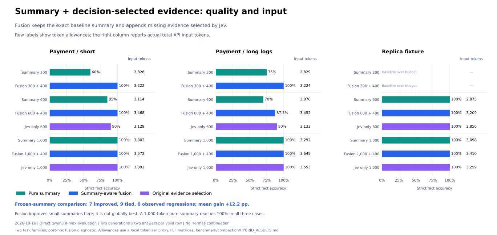

# 基于决策模型的上下文压缩

`compact_context` 为旧工具结果生成可恢复的预览建议：判断证据对当前任务是否仍有用，保留工具调用和不确定的证据。
原始历史由宿主持有。流程使用通用 `as_decision_model` 接口，当前 `agentscope` 适配器连接 TypeSafe/Jev。


## 一次压缩如何工作

1. **宿主先归档。** 提供 AgentScope 2.x JSON 消息、`goal`、可选的 `next_action`、只读工具允许列表，以及
   `source_refs`：原始调用 ID 到归档来源的映射。引用是宿主定义的标识；ReMe 不打开、验证或创建归档。
   宿主必须在应用建议前保存原始历史，并提供能根据引用取回原文的工具。没有引用的配对不参与压缩。
2. **确定性保护。** 按唯一 ID 配对 `tool_call` 和 `tool_result`。第一条、system、最近和显式保护的消息及调用保留。
   未完成或失败的调用、非文本结果、非法输入、工具名不一致和不明确的配对保留。`eligible_tool_names` 默认为空。
3. **展示有界证据。** 每批只携带本批候选的工具名、输入、结果头尾片段、字符数和完整性标记，同时携带目标、
   下一步行动和有限的首条、system、保护及近期文本。thinking 不发送。预览可能包含源码等数据，宿主应在推理前处理敏感内容。
4. **每对一个问题。** 判断“这份证据是否包含继续正确执行任务所需的信息”，不再判断能否重新获取。
   截断或缺失信息代表不确定。单个证据放不进请求预算时保留，不移除观测内容后继续盲判。
5. **只替换明确无关的结果。** 概率 `<= drop_threshold`（默认 `0.1`）时，允许替换为原文头尾片段和恢复引用。
   更高概率、缺失或非法答案保留原文。供应商错误和超时保留受影响证据；外部取消在请求清理后向上传播。

工具调用和消息都不删除。新结果只有更短时才替换。用户与 assistant 文本、thinking、元数据和输入原文不改变。
不可丢失的约束、审计回执和关键证据应显式保护，不能只依赖概率。默认阈值是保守起点，不代表已经校准。

## 配置与调用

```bash
pip install "reme-ai[core,decision]"
export DECISION_MODEL_API_KEY=your-typesafe-api-key
export DECISION_MODEL_BACKEND=agentscope
# 可选：DECISION_MODEL_NAME、DECISION_MODEL_BASE_URL
```

CLI 也从 `.env` 读取 `DECISION_MODEL_*`，详见[决策模型配置](./configuration.md#决策模型配置)。
省略模型名或配置为 `null` 时使用 SDK 默认模型。

在一个终端启动服务：

```bash
reme start config=decision_compaction
```

在另一个终端调用，引用应已由宿主归档并能够解析：

```bash
reme compact_context \
  goal='修复支付重试' next_action='检查重试实现' \
  eligible_tool_names='["search_code"]' source_refs='{"c1":"archive/demo/c1"}' \
  options='{"preserve_recent_messages":1}' \
  messages='[{"role":"user","content":[{"type":"text","text":"修复重试"}]},{"role":"assistant","content":[{"type":"tool_call","id":"c1","name":"search_code","input":"{\"path\":\"icons\"}","state":"finished"},{"type":"tool_result","id":"c1","name":"search_code","output":"旧图标搜索结果","state":"success"}]},{"role":"user","content":[{"type":"text","text":"接下来检查支付代码"}]}]'
```

短结果可能因为恢复标记反而更长而保持不变。配置继承默认服务和后台 Job；嵌入宿主时，可参考
[集成测试](https://github.com/agentscope-ai/ReMe/blob/main/tests/integration/test_decision_compaction.py)只装配压缩 Job 与决策组件。

## 主模型 token 预算

决策请求的估算预算与压缩后主模型输入预算独立。使用 `max_output_tokens` 时，宿主必须在构造 Step 时注入同步函数
`token_counter(messages)`，按实际模型输入格式计算 token，包含 system、工具定义和消息封装。函数必须返回非负整数。
缺少计数函数时在推理前报错。ReMe 的检索分词器不能代替模型 token 计数器。

```python
step = CompactContextStep(as_decision_model=decision_model, token_counter=count_model_input)
response = await step(
    messages=snapshot,
    goal="修复重试",
    next_action="检查补丁",
    source_refs=archive_refs,
    eligible_tool_names=["read_file"],
    options={"max_output_tokens": 32000},
)
```

已经满足预算时不调用模型。否则只在低概率候选内按概率从低到高替换，满足预算即停止；替换必须同时减少文本大小和
宿主 token 计数。不会为了满足预算删除必要或不确定的证据。仍然超限时返回 `reason="budget_exceeded"`、
`budget_met=false`，宿主应先执行摘要等后续策略。未指定预算时处理所有符合条件的低概率结果，`budget_met=null`，
由宿主自行检查最终输入。

## 返回值与默认配置

标准 Response 的 `answer` 包含 `schema_version=2`、建议 `messages`、`changed`、`reason`、`budget_met`、
`decisions` 和 `stats`。每个决策记录原始 `call_id`、内部 `id`、动作 `keep` / `preview`、`probability`、
`reason` 和 `source_ref`。原因区分保护、不确定、未观测、非法答案、供应商错误、超时和没有节省。
统计包括前后大小及宿主 token 数、候选和保护数量、最大批次状态估算 token、请求数、usage 和耗时，也写入响应元数据。

| 配置 | 默认值 | 含义 |
| --- | --- | --- |
| `drop_threshold` | `0.1` | 只有不高于此概率的结果允许替换为预览 |
| `preserve_recent_messages` | `6` | 保护最近的消息数 |
| `evidence_chars` | `2000` | 每个输入、结果预览或近期文本的字符上限 |
| `preview_chars` | `300` | 建议结果保留的头尾片段字符上限，不含恢复标记 |
| `max_state_tokens` | `25000` | 决策状态的估算上限 |
| `max_request_tokens` | `30000` | 状态和问题的估算上限，含 256 token 开销预留 |
| `max_output_tokens` | `null` | 可选的宿主计数预算 |
| `max_concurrency` | `4` | 最大并发请求数 |
| `total_timeout_seconds` | `30` | 包含排队的总体请求超时 |

## 验证

两个集成场景分别模拟支付重试排障和副本延迟调查，让重要源码、日志与已经结束的无关任务竞争。
配置凭证后显式运行：

```bash
REME_RUN_DECISION_INTEGRATION=1 pytest tests/integration/test_decision_compaction.py -v -s
```

只有模型请求调用外部服务，历史中的工具不会执行。这些用例验证行为，不证明通用任务成功率。
真实 trajectory 评测应对比近期保留和纯规则预览，同时测量恢复次数、继续执行的质量、时延、总成本和 token 节省。
ReMe 不会自动生成摘要或写入长期记忆。

## 压缩策略对比

[Benchmark 评测方案与完整结果](https://github.com/jinliyl/ReMe/blob/ba57fc5cdb80f3eb8b53ea12588254f3212a2c6f/benchmark/compaction/HYBRID_RESULTS.md)比较纯摘要、Jev 原文筛选和摘要感知融合。
下图统一使用 2026-10-16 的分块方式与严格事实评分，展示支付短样本、长日志变体和独立副本故障 fixture。
评测直接调用 Qwen；支付 trajectory 由 Hermes 采集，评测阶段没有运行 Hermes 代理继续执行。

融合保留同一份基础摘要，让决策模型看到摘要后选择缺失或不够精确的证据，再追加最多 400 token 原文；
只选择增量有用概率不低于 0.5 的片段。图中行名是预算上限，右列是 API 返回的实际总输入 token，包含公共上下文。
融合与基础摘要的总预算不同；更大预算的纯摘要和纯原文筛选同时列出，供质量与输入量对比。



16 份有效冻结摘要实例中，融合有 7 份严格得分提升、9 份持平，未观察到下降，平均提高 12.2 个百分点。
300-token 基础摘要的支付短样本从 60% 到 100%，长日志从 75% 到 100%。这支持“摘要加互补原文”可以修复小摘要的遗漏。

现有数据不能证明融合全局最优：1000-token 纯摘要在三个场景均达到 100%；长日志中，它使用 3292 个实际输入 token，
而 600 + 400 融合使用 3452 个、得分 87.5%。因此应根据输入预算选择策略，不能把追加输入后的提升当作同预算优势。
这是两个任务族上的事后诊断，包含增噪变体与重复生成，不是独立测试集或单调性保证。
完整预算矩阵、失败样本、选择对照及早期实验见 Benchmark 文档。融合仅在实验脚本实现，未改变上述 `compact_context` 生产契约。
